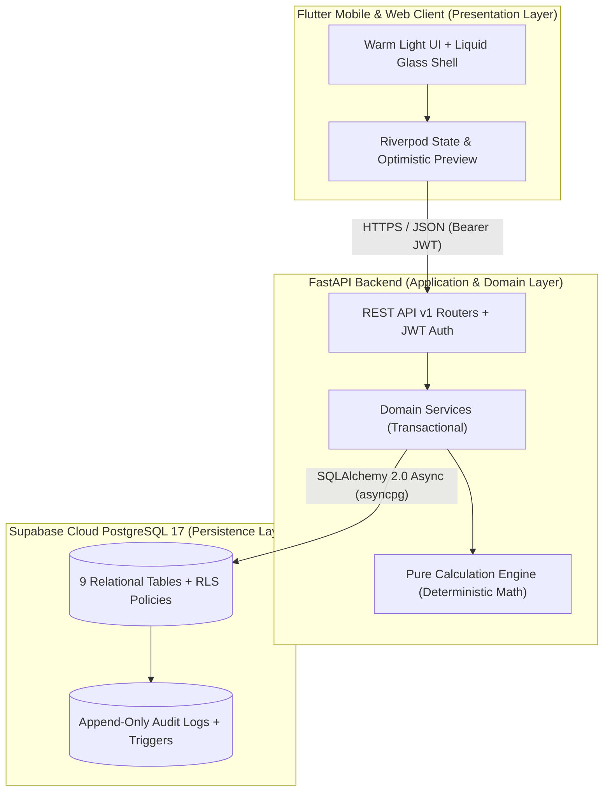

# AttendHub — Documentation Hub

  <strong>Track · Plan · Stay Above</strong> 
  <em>Comprehensive engineering, architecture, API, database, security, UI/UX, and deployment documentation for AttendHub.</em>

---

## 📚 Documentation Index

| Document | Scope & Contents |
|---|---|
| **[Architecture & Design](architecture.md)** | 4-layer system architecture, deterministic attendance mathematics, semester & user isolation, 7-step setup wizard, and rendering optimizations. |
| **[REST API Reference](api.md)** | Complete v1 endpoint catalog (`/auth`, `/profile`, `/semesters`, `/subjects`, `/timetable`, `/sessions`, `/attendance`, `/dashboard`, `/analytics`, `/calendar`, `/holidays`, `/imports`, `/health`). |
| **[Database & Supabase RLS](database.md)** | PostgreSQL 17 entity-relationship schema, all 9 table definitions, performance indexes, Row-Level Security (RLS) policies, and immutable audit triggers. |
| **[Frontend & UI/UX Design System](frontend-and-design.md)** | Warm Light Theme palette, Liquid Glass material rules, typography/spacing tokens, Persistent App Shell, Riverpod state management, and screen workflows. |
| **[Security & OWASP Compliance](security.md)** | OWASP ASVS 5.0.0 & API Top 10 alignment, Argon2id hashing, JWT lifecycle, IDOR protection, rolling 3-day edit window, and zero-retention file uploads. |
| **[Deployment & Release Guide](deployment.md)** | Cloud deployment on Render (`render.yaml`), Supabase connection pooling, `/health` keep-alive probes, Docker Compose, Android APK builds, and runtime Server URL switching. |
| **[Local Development Guide](development.md)** | Prerequisites, FastAPI virtual environment setup, `.env` configuration, Flutter client execution, and coding conventions. |
| **[Testing & Verification Report](testing.md)** | Multi-tier testing strategy, mathematical edge-case matrix, 19 backend `pytest` suites, and 58 Flutter unit/widget/responsive test suites. |
| **[Agent Skills & Preflight Protocol](agent-skills.md)** | Specialist engineering skills inventory, authority hierarchy, and mandatory pre-edit preflight rules. |

---

## 🧭 System Overview

---

## 🛡️ Core Product Invariants

Every layer of AttendHub strictly enforces the following eight engineering invariants:

1. **Attendance Threshold Defaults**:
   - `minimum_attendance = 75.0%`
   - `personal_target = 75.0%`
   - `low_attendance_alert = 70.0%`
   - Never use or fall back to an `80%` default.
2. **Conducted & Attendance Formula**:
   - $\text{Conducted } (C) = \text{Attended } (A) + \text{Absent } (B)$.
   - Sessions marked `NOT_HELD`, `CANCELLED`, or scheduled on registered `HOLIDAY` dates are strictly excluded from $C$.
   - When $C = 0$, attendance percentage is `None` (`"No attendance data yet"`), never `0%` or division-by-zero.
   - Whole-semester attendance aggregates raw totals ($\frac{\sum A}{\sum C} \times 100$) and **never** averages subject percentages.
3. **Deterministic Forecasting**:
   - **Classes Needed to Reach Target ($r$)**:
     $$x = \max\left(0, \left\lceil \frac{r \cdot C - A}{1 - r} \right\rceil\right)$$
   - **Maximum Safe Absences ($r$)**:
     $$x = \max\left(0, \left\lfloor \frac{A - r \cdot C}{r} \right\rfloor\right)$$
   - If current attendance is below minimum ($P < \text{minimum}$), safe absences is strictly `0`.
   - If current attendance is at or above target ($P \ge \text{target}$), status is `"Already at target"`.
4. **Semester Context Isolation**:
   - Switching semesters (`POST /api/v1/semesters/switch` or `POST /api/v1/semesters/{id}/activate`) switches subjects, timetable routines, class sessions, holidays, attendance records, and analytics completely without deleting historical semesters.
5. **Multi-Tenant User Isolation**:
   - Every query and mutation enforces ownership by `user_id` at both the SQLAlchemy service layer and Supabase PostgreSQL Row-Level Security (RLS) layer.
6. **Time-Aware Session Intelligence**:
   - When class start/end times exist: past $\to$ `Done`, active $\to$ `Current` (`Now`), future $\to$ `Upcoming`.
   - When timings are omitted, no temporal state is fabricated.
7. **Review-Before-Save & Zero-Retention Imports**:
   - Uploaded timetable and holiday files (`PDF`, `PNG`, `JPG`, `WEBP`, `CSV`) are validated and parsed in transient memory (< 10MB) into client-side drafts. Raw files are never stored in PostgreSQL or object storage buckets.
8. **Safe Subject Archiving**:
   - Deleting a subject with historical attendance soft-archives it (`is_active = False`) to preserve audit and calculation integrity.
