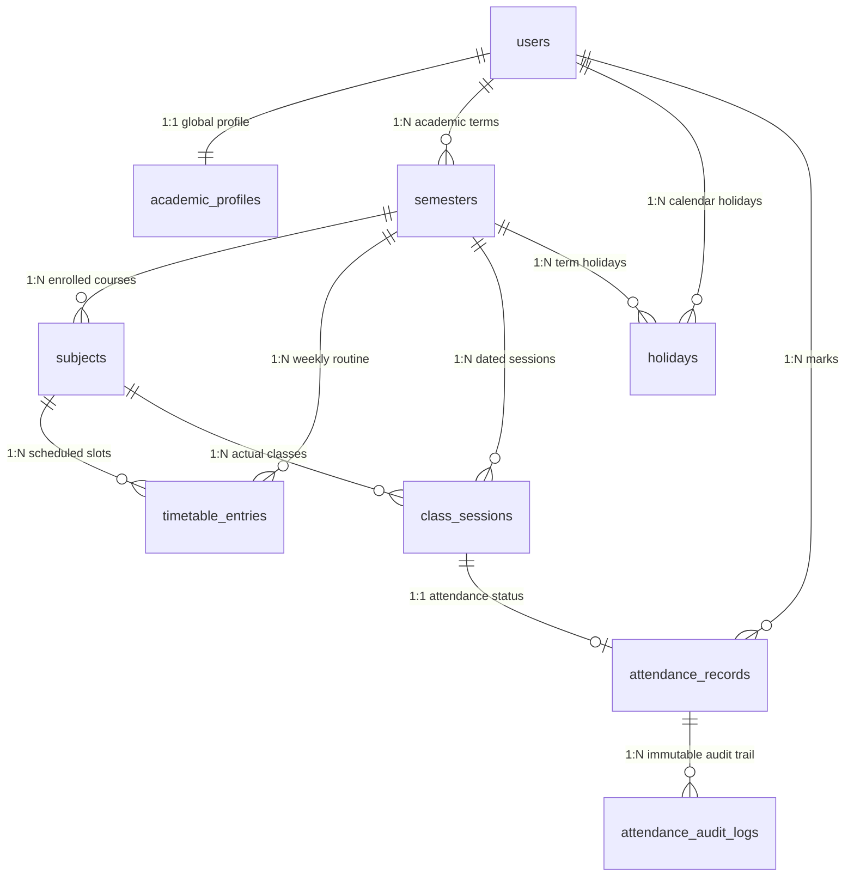

# AttendHub — Database Architecture & Schema Reference

AttendHub uses a relational PostgreSQL 17 persistence model engineered for transactional consistency, referential integrity, Row-Level Security (RLS), and complete semester isolation.

---

## 1. Entity Relationship Diagram

---

## 2. Table Specifications

The authoritative SQL DDL is maintained in [`supabase/schema.sql`](../supabase/schema.sql) and mirrored in SQLAlchemy 2.0 ORM models under [`backend/app/models/`](../backend/app/models/).

### 2.1 `users`
Represents student accounts with Argon2id password hashes.
| Column | Type | Constraints | Description |
|---|---|---|---|
| `id` | `VARCHAR(36)` | `PRIMARY KEY` | UUID string identifier |
| `email` | `VARCHAR(255)` | `UNIQUE, NOT NULL, INDEX` | Verified student email address |
| `hashed_password` | `VARCHAR(255)` | `NOT NULL` | Argon2id password hash |
| `full_name` | `VARCHAR(100)` | `NOT NULL` | Student's full name |
| `avatar_initial` | `VARCHAR(5)` | `DEFAULT 'A', NOT NULL` | Initial displayed in top bar avatar |
| `is_active` | `BOOLEAN` | `DEFAULT TRUE, NOT NULL` | Account active state |
| `created_at` | `TIMESTAMPTZ` | `DEFAULT now(), NOT NULL` | Account creation timestamp (UTC) |
| `updated_at` | `TIMESTAMPTZ` | `DEFAULT now(), NOT NULL` | Last profile update timestamp (UTC) |

### 2.2 `academic_profiles`
Maintains global institutional identity and attendance threshold settings (`75.0%` defaults).
| Column | Type | Constraints | Description |
|---|---|---|---|
| `id` | `VARCHAR(36)` | `PRIMARY KEY` | Profile UUID |
| `user_id` | `VARCHAR(36)` | `FK(users.id) ON DELETE CASCADE, UNIQUE` | Owner student reference |
| `university_name` | `VARCHAR(200)` | `NOT NULL` | University or College name |
| `course_name` | `VARCHAR(200)` | `NOT NULL` | Degree / Program title |
| `student_id_number` | `VARCHAR(100)` | `NULLABLE` | Enrollment / Roll number |
| `academic_duration_years` | `INTEGER` | `DEFAULT 4, NOT NULL` | Program duration in years |
| `academic_session_start` | `INTEGER` | `DEFAULT 2024, NOT NULL` | Cohort start year |
| `academic_session_end` | `INTEGER` | `DEFAULT 2028, NOT NULL` | Expected graduation year |
| `current_semester_id` | `VARCHAR(36)` | `NULLABLE` | Active semester UUID pointer |
| `minimum_attendance` | `NUMERIC(5,2)` | `DEFAULT 75.0, CHECK (0..100)` | Mandatory attendance requirement |
| `personal_target` | `NUMERIC(5,2)` | `DEFAULT 75.0, CHECK (0..100)` | Student's personal target goal |
| `low_attendance_alert` | `NUMERIC(5,2)` | `DEFAULT 70.0, CHECK (0..100)` | Early warning alert threshold |

### 2.3 `semesters`
Defines discrete academic terms. All subjects, timetables, and class sessions belong to a semester.
| Column | Type | Constraints | Description |
|---|---|---|---|
| `id` | `VARCHAR(36)` | `PRIMARY KEY` | Semester UUID |
| `user_id` | `VARCHAR(36)` | `FK(users.id) ON DELETE CASCADE, INDEX` | Owner student reference |
| `semester_number` | `INTEGER` | `NOT NULL, CHECK (1..12)` | Semester ordinal (`1` to `12`) |
| `label` | `VARCHAR(100)` | `NOT NULL` | Display label (e.g., `"5th Semester"`) |
| `start_date` | `DATE` | `NOT NULL` | Term start date |
| `end_date` | `DATE` | `NOT NULL, CHECK (end_date >= start_date)` | Term end date |
| `status` | `VARCHAR(20)` | `DEFAULT 'ACTIVE'` | `ACTIVE`, `COMPLETED`, or `UPCOMING` |
| `is_active` | `BOOLEAN` | `DEFAULT TRUE, INDEX` | Currently active semester flag |
| `total_weeks` | `INTEGER` | `DEFAULT 16, CHECK (>= 1)` | Total instructional weeks in term |

### 2.4 `subjects`
Course units enrolled within a specific semester.
| Column | Type | Constraints | Description |
|---|---|---|---|
| `id` | `VARCHAR(36)` | `PRIMARY KEY` | Subject UUID |
| `semester_id` | `VARCHAR(36)` | `FK(semesters.id) ON DELETE CASCADE, INDEX` | Parent semester reference |
| `name` | `VARCHAR(150)` | `NOT NULL` | Subject title |
| `code` | `VARCHAR(50)` | `NULLABLE` | Course code (e.g., `CS-501`) |
| `faculty_name` | `VARCHAR(100)` | `NULLABLE` | Instructor name |
| `color` | `VARCHAR(20)` | `DEFAULT '#C96E5B', NOT NULL` | Semantic hex accent color |
| `icon` | `VARCHAR(50)` | `DEFAULT 'book', NOT NULL` | Subject icon identifier |
| `is_active` | `BOOLEAN` | `DEFAULT TRUE, INDEX` | Active / Soft-archived flag |

> **Subject Lifecycle Invariant**: Deleting a subject with recorded attendance performs a soft archive (`is_active = FALSE`) so historical session counts remain intact.

### 2.5 `timetable_entries`
Recurring weekly routine schedule slots.
| Column | Type | Constraints | Description |
|---|---|---|---|
| `id` | `VARCHAR(36)` | `PRIMARY KEY` | Timetable slot UUID |
| `semester_id` | `VARCHAR(36)` | `FK(semesters.id) ON DELETE CASCADE, INDEX` | Parent semester reference |
| `subject_id` | `VARCHAR(36)` | `FK(subjects.id) ON DELETE CASCADE, INDEX` | Subject reference |
| `day_of_week` | `INTEGER` | `CHECK (0..6)` | `0` = Monday ... `6` = Sunday |
| `start_time` | `VARCHAR(10)` | `NULLABLE` | Class start time (`"HH:MM"`) |
| `end_time` | `VARCHAR(10)` | `NULLABLE` | Class end time (`"HH:MM"`) |
| `faculty_name` | `VARCHAR(100)` | `NULLABLE` | Optional slot faculty override |
| `room` | `VARCHAR(50)` | `NULLABLE` | Classroom / Lab identifier |
| `effective_from` | `DATE` | `NULLABLE` | Optional schedule effective start |
| `effective_to` | `DATE` | `NULLABLE` | Optional schedule effective end |

### 2.6 `class_sessions`
Discrete class instances occurring on specific calendar dates.
| Column | Type | Constraints | Description |
|---|---|---|---|
| `id` | `VARCHAR(36)` | `PRIMARY KEY` | Session UUID |
| `semester_id` | `VARCHAR(36)` | `FK(semesters.id) ON DELETE CASCADE, INDEX` | Semester reference |
| `subject_id` | `VARCHAR(36)` | `FK(subjects.id) ON DELETE CASCADE, INDEX` | Subject reference |
| `date` | `DATE` | `NOT NULL, INDEX` | Calendar date of session |
| `start_time` | `VARCHAR(10)` | `NULLABLE` | Session start time (`"HH:MM"`) |
| `end_time` | `VARCHAR(10)` | `NULLABLE` | Session end time (`"HH:MM"`) |
| `faculty_name` | `VARCHAR(100)` | `NULLABLE` | Instructor name |
| `room` | `VARCHAR(50)` | `NULLABLE` | Classroom / Lab |
| `session_status` | `VARCHAR(20)` | `DEFAULT 'SCHEDULED'` | `SCHEDULED`, `HELD`, `CANCELLED`, `HOLIDAY`, `NOT_HELD` |
| `is_extra` | `BOOLEAN` | `DEFAULT FALSE, NOT NULL` | Unscheduled extra class indicator |

> **Virtual-to-Concrete Materialization**: Read endpoints (`GET /attendance/day`, `GET /timetable/weekly-status`) synthesize virtual schedule slots in memory without writing rows. Concrete `class_sessions` rows are materialized only when attendance is confirmed via `POST /attendance/bulk` or when an extra class is created via `POST /sessions/extra`.

### 2.7 `attendance_records`
Student attendance marks for concrete class sessions.
| Column | Type | Constraints | Description |
|---|---|---|---|
| `id` | `VARCHAR(36)` | `PRIMARY KEY` | Attendance record UUID |
| `class_session_id` | `VARCHAR(36)` | `FK(class_sessions.id) ON DELETE CASCADE, UNIQUE` | Target session reference |
| `user_id` | `VARCHAR(36)` | `FK(users.id) ON DELETE CASCADE, INDEX` | Student owner reference |
| `status` | `VARCHAR(20)` | `NOT NULL, CHECK (ATTENDED, ABSENT, NOT_HELD)` | Recorded attendance state |
| `marked_at` | `TIMESTAMPTZ` | `DEFAULT now(), NOT NULL` | Initial marking timestamp |
| `updated_at` | `TIMESTAMPTZ` | `DEFAULT now(), NOT NULL` | Last modification timestamp |
| `source` | `VARCHAR(30)` | `DEFAULT 'manual', NOT NULL` | `manual`, `bulk_today`, `initial_setup` |

### 2.8 `attendance_audit_logs`
Append-only immutable audit trail recording all attendance status changes.
| Column | Type | Constraints | Description |
|---|---|---|---|
| `id` | `VARCHAR(36)` | `PRIMARY KEY` | Audit log UUID |
| `attendance_record_id` | `VARCHAR(36)` | `FK(attendance_records.id) ON DELETE CASCADE, INDEX` | Target attendance record |
| `original_status` | `VARCHAR(20)` | `NULLABLE` | Status prior to edit |
| `new_status` | `VARCHAR(20)` | `NOT NULL, CHECK (ATTENDED, ABSENT, NOT_HELD)` | Status after edit |
| `changed_at` | `TIMESTAMPTZ` | `DEFAULT now(), NOT NULL` | Mutation timestamp (UTC) |
| `changed_by` | `VARCHAR(36)` | `NOT NULL` | Actor `user_id` |
| `reason` | `VARCHAR(255)` | `NULLABLE` | Reason for correction |

### 2.9 `holidays`
Registered academic holidays, festivals, and multi-day breaks.
| Column | Type | Constraints | Description |
|---|---|---|---|
| `id` | `VARCHAR(36)` | `PRIMARY KEY` | Holiday UUID |
| `user_id` | `VARCHAR(36)` | `FK(users.id) ON DELETE CASCADE, INDEX` | Student owner reference |
| `semester_id` | `VARCHAR(36)` | `FK(semesters.id) ON DELETE CASCADE, NULLABLE` | Optional semester scoping |
| `start_date` | `DATE` | `NOT NULL, INDEX` | Holiday start date |
| `end_date` | `DATE` | `NOT NULL, CHECK (end_date >= start_date)` | Holiday end date |
| `title` | `VARCHAR(150)` | `NOT NULL` | Holiday or break title |
| `category` | `VARCHAR(50)` | `DEFAULT 'University Holiday'` | `University Holiday`, `Festival`, `Semester Break`, `Exam Break`, `Academic`, `Other` |
| `notes` | `VARCHAR(255)` | `NULLABLE` | Optional description |
| `source` | `VARCHAR(30)` | `DEFAULT 'manual', NOT NULL` | `manual`, `import_confirmed`, `setup_wizard` |

---

## 3. Performance Indexes

Defined in [`supabase/schema.sql`](../supabase/schema.sql):
- `idx_academic_profiles_user_id` on `academic_profiles(user_id)`
- `idx_semesters_user_id` and `idx_semesters_user_active` on `semesters(user_id, is_active)`
- `idx_subjects_semester_id` and `idx_subjects_semester_active` on `subjects(semester_id, is_active)`
- `idx_timetable_entries_semester_id`, `idx_timetable_entries_subject_id`, and `idx_timetable_entries_day` on `timetable_entries(semester_id, day_of_week)`
- `idx_class_sessions_semester_id`, `idx_class_sessions_subject_id`, `idx_class_sessions_date`, and `idx_class_sessions_semester_date` on `class_sessions(semester_id, date)`
- `idx_holidays_user_id`, `idx_holidays_semester_id`, and `idx_holidays_dates` on `holidays(start_date, end_date)`
- `idx_attendance_records_user_id`, `idx_attendance_records_session_id`, and `idx_attendance_records_user_status` on `attendance_records(user_id, status)`
- `idx_audit_logs_record_id` and `idx_audit_logs_changed_by` on `attendance_audit_logs`

---

## 4. Supabase Row-Level Security (RLS) & Triggers

1. **Tenant Isolation Policies**:
   - Every table in `public` has RLS enabled (`ALTER TABLE ... ENABLE ROW LEVEL SECURITY`).
   - Direct user tables check `(select auth.uid())::text = user_id`.
   - Semester-scoped tables (`subjects`, `timetable_entries`, `class_sessions`) check `EXISTS (SELECT 1 FROM public.semesters s WHERE s.id = semester_id AND s.user_id = (select auth.uid())::text)`.
2. **Immutable Audit Trigger**:
   - `tr_attendance_audit_log` automatically fires `public.log_attendance_correction()` on `AFTER UPDATE` of `attendance_records` whenever `OLD.status IS DISTINCT FROM NEW.status`.
   - `attendance_audit_logs` enforces `USING (false)` on `UPDATE` and `DELETE` policies.
3. **Zero Binary Retention**:
   - No `BYTEA`, `BLOB`, or raw document columns exist in the schema. Uploaded routine/holiday files are parsed in memory and discarded immediately.
