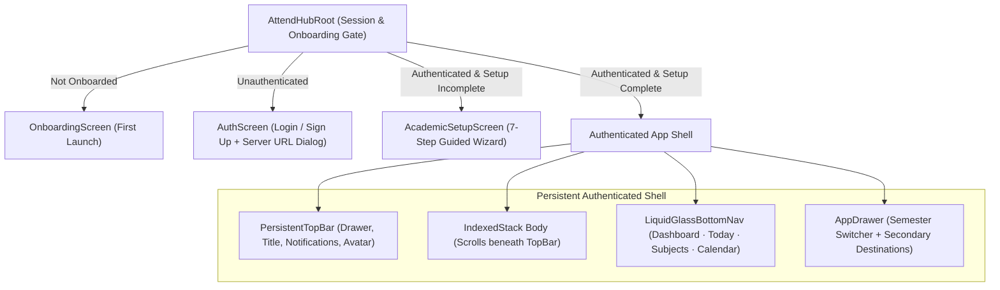

# AttendHub — Mobile Client Architecture & UI/UX Design System

This document details the Flutter presentation layer architecture, the **Warm Light Liquid Glass** design system, Riverpod state management, and interactive student workflows implemented in `mobile/`.

---

## 1. Design Philosophy & Visual Direction

AttendHub is designed as a calm, high-craft student productivity companion rather than an administrative university ERP.

> **Minimal enough to feel premium, rich enough to feel complete.**

Key pillars:
- **Warm Editorial Light Theme**: Soft warm-white and alabaster surfaces replacing sterile pure-white or harsh dark backgrounds.
- **Semantic Accents**: Colours communicate attendance standing (`Healthy`, `Caution`, `Critical`, `No Data`) and are always paired with explicit text labels and icons.
- **Restrained Liquid Glass**: Translucent blurred surfaces (`BackdropFilter`) reserved for persistent navigation shells, floating controls, modals, and hero summary cards—never stacked over dense scrolling list rows.
- **Procedural Nature Artwork**: Custom vector canvas painters (`LandscapeHeaderWidget`) rendering sunrise, layered mountains, pine trees, and birds behind top headers.

---

## 2. Design Tokens Reference

All design tokens are centralized in [`mobile/lib/core/theme/`](../mobile/lib/core/theme/):

### 2.1 Color Palette (`app_colors.dart`)

| Token | Hex / Value | Semantic Usage |
|---|---|---|
| `AppColors.background` | `#F7F1EC` | Primary warm off-white scaffold background |
| `AppColors.surface` | `#FFFDFC` | Elevated card & content surface |
| `AppColors.glass` | `rgba(255, 255, 255, 0.58)` | Translucent liquid glass fill |
| `AppColors.terracotta` | `#C96E5B` | Primary brand accent, primary buttons, active tab |
| `AppColors.rose` | `#D98786` | Secondary warm gradient & accent |
| `AppColors.sage` | `#72A68A` | `ATTENDED`, `HEALTHY` ($\ge 75\%$), target reached |
| `AppColors.amber` | `#D9A35B` | `CAUTION`, approaching threshold, low buffer |
| `AppColors.coral` | `#D86A62` | `ABSENT`, `CRITICAL` ($< 75\%$), recovery required |
| `AppColors.lavender` | `#8F7BAE` | Academic events, exams, and holiday categories |
| `AppColors.ink` | `#202020` | Primary high-contrast typography |
| `AppColors.mutedInk` | `#6E6A67` | Supporting labels, captions, and metadata |
| `AppColors.divider` | `rgba(48, 38, 34, 0.08)` | Hairline card and section dividers |

### 2.2 Corner Radii (`app_radii.dart`) & Spacing (`app_spacing.dart`)
- **Spacing Scale**: `4, 8, 12, 16, 20, 24, 32, 40, 48` logical pixels.
- **Radius Scale**:
  - Small control / badge: `12px – 14px`
  - Standard card: `18px`
  - Feature / Hero card: `22px – 24px`
  - Modal bottom sheet / floating nav pill: `28px – 32px`

---

## 3. Application Shell & Navigation Architecture

Implemented in [`mobile/lib/app/app.dart`](../mobile/lib/app/app.dart):

### 3.1 Primary vs. Secondary Navigation
- **Primary Bottom Navigation (`LiquidGlassBottomNav`)**:
  1. **Dashboard** (`DashboardScreen`) — *"Where do I stand?"*
  2. **Today** (`TodayScreen`) — *"What happened today?"*
  3. **Subjects** (`SubjectsScreen`) — *"How is each subject doing and how do I manage my subjects?"*
  4. **Calendar** (`CalendarScreen`) — *"When are classes, holidays, and important academic dates?"*
  - Supports both standard tap navigation and an iOS-inspired press-drag-release horizontal pill gesture.
- **Secondary First-Class Screens** (accessible via `AppDrawer`, `PersistentTopBar`, and contextual links):
  - **Analytics** (`AnalyticsScreen`) — Deep per-subject deterministic forecasting and recovery insights.
  - **Holidays** (`HolidaysScreen`) — Categorized upcoming/past academic holidays and multi-day breaks.
  - **Profile** (`ProfileScreen`) — Academic identity, attendance thresholds, and semester switching.
  - **Academic Setup Wizard** (`AcademicSetupScreen`) — 7-step unified configuration and semester setup editor.
  - **Settings** (`SettingsScreen`) — Server URL configuration, thresholds, and account preferences.

---

## 4. Feature Modules & Riverpod State Management

The mobile codebase follows a strict feature-first structure under `mobile/lib/features/`:

| Feature Module | Primary Screen & Widgets | Riverpod Providers | Responsibilities |
|---|---|---|---|
| `auth/` | `AuthScreen` | `authProvider` | Login, registration, token storage, logout, and runtime Server URL configuration modal. |
| `setup/` | `AcademicSetupScreen` | `setupProvider` | 7-step wizard for profile, semester, subjects, routine, holidays, and baseline attendance (`POST /profile/setup`). |
| `dashboard/` | `DashboardScreen` | `dashboardProvider` | Overall attendance ring, semester progress dial, today's snapshot, attention list, quick insight, and 7-day trend. |
| `today/` | `TodayScreen` | `todayProvider` | Daily 3-state attendance marking (`ATTENDED`, `ABSENT`, `NOT_HELD`), rolling 3-day date selector, extra class creation, and live impact preview. |
| `subjects/` | `SubjectsScreen`, `SubjectDetailScreen` | `subjectsProvider`, `weeklyRoutineProvider` | Subject CRUD, soft archiving, weekly routine status grid (`/timetable/weekly-status`), and subject-level forecast detail. |
| `calendar/` | `CalendarScreen` | `calendarProvider` | Monthly grid with compact attendance/holiday dot markers and selected-date session breakdown. |
| `holidays/` | `HolidaysScreen` | `holidaysProvider` | Upcoming/past holiday filtering, category tags, manual creation, and holiday document import. |
| `analytics/` | `AnalyticsScreen` | `analyticsOverviewProvider` | Whole-semester raw aggregation, per-subject safe absences & recovery calculators, and rule-based insights. |
| `imports/` | `RoutineImportDialog`, `HolidayImportDialog` | Ephemeral component state | Upload/CSV parsing, interactive draft review/editing, and explicit transactional confirmation or zero-retention discard. |
| `profile/` | `ProfileScreen` | `profileProvider`, `semestersProvider` | Global academic profile editing, target threshold adjustments, and authoritative semester switching. |

### Cascading Semester Invalidation
When a student switches semesters (`semestersProvider.notifier.switchSemester`), the client awaits server confirmation (`200 OK`) and immediately invalidates all semester-scoped providers:
- `dashboardProvider`
- `todayProvider`
- `subjectsProvider`
- `calendarProvider`
- `holidaysProvider`
- `analyticsOverviewProvider`

---

## 5. Rendering Performance & Accessibility Standards

1. **Vector Landscape Caching**:
   - `LandscapeHeaderWidget` wraps procedural `CustomPaint` artwork inside a `RepaintBoundary` and raster-caches at `800px` width to eliminate GPU raster thread spikes during vertical scrolling.
2. **State Coverage**:
   - Shared state components in [`mobile/lib/shared/widgets/state_views.dart`](../mobile/lib/shared/widgets/state_views.dart) and [`shimmer_skeleton.dart`](../mobile/lib/shared/widgets/shimmer_skeleton.dart) provide dedicated **Loading**, **Empty**, **Error (with Retry)**, and **Success** states for every screen.
3. **Accessibility & Viewport Adaptation**:
   - Minimum `44x44` logical pixel interactive targets.
   - Tested and verified zero `RenderFlex` overflows across `320px`, `360px`, `375px`, `393px`, `412px`, and `430px+` screen widths.
