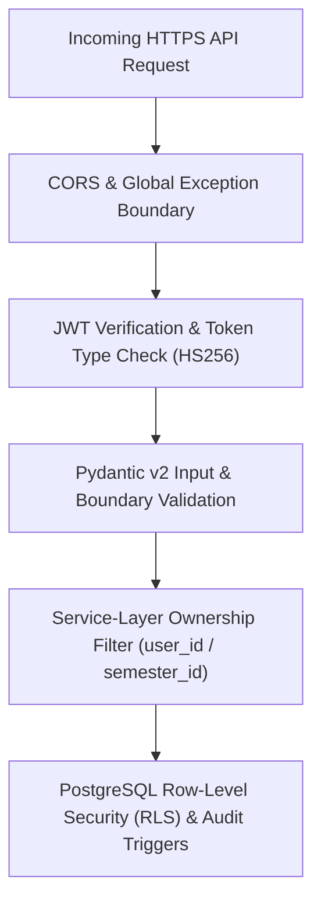

# AttendHub — Security Architecture & OWASP Compliance

AttendHub is engineered in alignment with **OWASP Application Security Verification Standard (ASVS) 5.0.0** and the **OWASP API Security Top 10**. This document details the cryptographic, authorization, database, and input validation controls enforced across the stack.

---

## 1. Security Defense-in-Depth Overview

---

## 2. Authentication & Cryptographic Standards (OWASP ASVS V2 & V3)

### 2.1 Password Hashing (Argon2id)
- Implemented in [`backend/app/core/security.py`](../backend/app/core/security.py) using `pwdlib` (`Argon2Hash`).
- Plaintext passwords are never logged, persisted, or returned in any API response.
- Minimum password length (8–128 characters) is enforced at the Pydantic schema boundary (`UserRegister`).

### 2.2 JWT Access & Refresh Token Separation
- **Access Tokens**:
  - Signed with `settings.JWT_SECRET` using `HS256`.
  - Contains claims `{"sub": user_id, "exp": ..., "type": "access"}`.
  - Validated on every protected route via `Depends(get_current_user)` in [`backend/app/api/dependencies.py`](../backend/app/api/dependencies.py).
- **Refresh Tokens**:
  - Signed with a **separate** cryptographic key (`settings.REFRESH_TOKEN_SECRET`).
  - Contains claims `{"sub": user_id, "exp": ..., "type": "refresh"}`.
  - `POST /api/v1/auth/refresh` explicitly verifies `"type" == "refresh"`, preventing access tokens from being replayed as refresh tokens or vice versa.

---

## 3. Multi-Tenant Authorization & IDOR Prevention (OWASP API1:2023)

Broken Object Level Authorization (BOLA / IDOR) is prevented through mandatory tenant scoping:

1. **No Client-Supplied `user_id` Trust**:
   - Mutations never accept `user_id` from request payloads; the actor identity is always derived from the verified JWT token (`current_user.id`).
2. **Hierarchical Ownership Verification**:
   - Entities directly owned by a user (`academic_profiles`, `semesters`, `holidays`, `attendance_records`) are queried with `.where(Model.user_id == current_user.id)`.
   - Entities scoped to a semester (`subjects`, `timetable_entries`, `class_sessions`) are joined against `Semester` with `.where(Semester.user_id == current_user.id)`.
   - Attempting to read, update, or delete another user's subject, semester, timetable slot, or attendance record raises `HTTP 403 Forbidden` or `HTTP 404 Not Found` (verified in `test_cross_user_isolation_and_idor_prevention`).

---

## 4. Database Security & Immutable Audit Trail

Defined in [`supabase/schema.sql`](../supabase/schema.sql):

### 4.1 Row-Level Security (RLS)
- All 9 tables in the `public` schema explicitly enable RLS (`ALTER TABLE ... ENABLE ROW LEVEL SECURITY`).
- Policies restrict `SELECT`, `INSERT`, `UPDATE`, and `DELETE` to `authenticated` users matching `(select auth.uid())::text = user_id` (or owning the parent `semester_id`).

### 4.2 Append-Only Attendance Audit Logs
- Whenever an existing `attendance_records` row is modified (`PATCH /api/v1/attendance/{id}` or re-saving via `POST /api/v1/attendance/bulk`), an `AttendanceAuditLog` entry is created recording:
  - `attendance_record_id`
  - `original_status`
  - `new_status`
  - `changed_at` (UTC timestamp)
  - `changed_by` (`user_id`)
  - `reason`
- In PostgreSQL, `attendance_audit_logs` has `UPDATE` and `DELETE` RLS policies unconditionally set to `USING (false)`, making the audit trail append-only.
- Database trigger functions (`log_attendance_correction`, `handle_updated_at`) use `SECURITY INVOKER` and explicit `SET search_path = public` to prevent search-path injection.

---

## 5. Input Validation & Domain Integrity Controls (OWASP ASVS V5)

### 5.1 Rolling 3-Day Attendance Edit Window
- Enforced server-side in [`backend/app/services/attendance_service.py`](../backend/app/services/attendance_service.py):
  - Students may mark or update daily attendance only for dates within the rolling window `[today - 2 days, today]`.
  - Requests for future dates (`target_date > today`) or expired historical dates (`target_date < today - 2 days`) are rejected with `HTTP 400 Bad Request`.
- Historical baseline attendance prior to app adoption is entered once through the dedicated `starting_attendance` step of `POST /api/v1/profile/setup`.

### 5.2 Read-Only Query Purity
- `GET /api/v1/attendance/day` and `GET /api/v1/timetable/weekly-status` are strictly side-effect-free read queries.
- Scheduled classes that have not yet been marked are synthesized in memory with virtual IDs (`virtual:<timetable_entry_id>:<YYYY-MM-DD>`) rather than writing unconfirmed rows to PostgreSQL on `GET`.

### 5.3 Secure File Upload & Zero-Retention Policy
Enforced in [`backend/app/api/v1/routers/imports.py`](../backend/app/api/v1/routers/imports.py):
1. **Size Cap**: Rejects payloads exceeding `10 MB` (`10 * 1024 * 1024` bytes) with `HTTP 400`.
2. **Extension Allowlist**: Only `.pdf`, `.png`, `.jpg`, `.jpeg`, `.webp`, and `.csv` are accepted; executable scripts (`.exe`, `.sh`, `.py`, `.html`, `.js`) are immediately rejected.
3. **MIME Type Validation**: Verifies `Content-Type` against `{"application/pdf", "image/png", "image/jpeg", "image/webp", "text/csv", "text/plain"}`.
4. **Zero Storage Retention**: Uploaded bytes are parsed in memory into structured draft entries (`ImportParseResponse`) and immediately garbage-collected. No raw files are persisted to disk, database columns, or cloud storage buckets.
